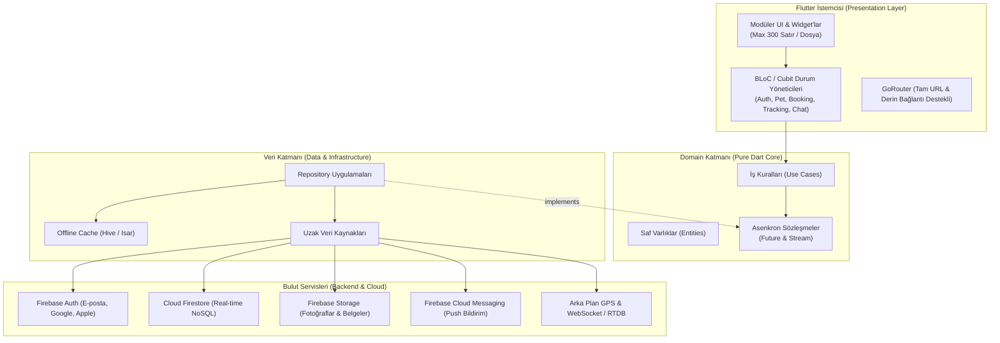
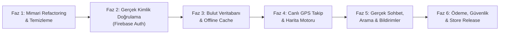
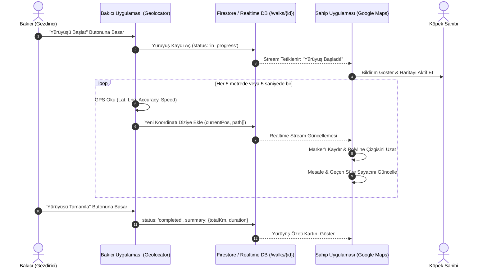

# PawCare — Canlıya Geçiş (Production-Ready) Ana Mimari ve Geliştirme Planı (`plan_2.md`)

> **Rol & Yaklaşım:** Senior Software Architect & Tech Lead  
> **Hedef:** PawCare projesini yerel/öğrenci prototipinden, App Store ve Google Play'de binlerce kullanıcının güvenle kullanabileceği, ölçeklenebilir, test edilebilir ve bulut destekli kurumsal bir ürüne dönüştürmek.  
> **Tarih:** 2026-11-05  

---

## 1. Yönetici Özeti ve Mimari Vizyon

Mevcut PawCare projesi, harika bir görsel kimliğe (Design System, mikro animasyonlar, koyu tema uyumu) ve Clean Architecture niyetine sahiptir. Ancak projenin derinliklerinde canlıya çıkışı imkânsız kılan **4 yapısal darboğaz** bulunmaktadır:

1. **Çift Başlı Durum (Dual State):** `flutter_bloc` varken arka planda 844 satırlık monolitik bir `AppState` nesnesinin (`ChangeNotifier`) veri kaynağı gibi kullanılması.
2. **Devasa Monolitler:** `app_shell.dart` (2331 satır), `dog_profile_screen.dart` (1380 satır) ve `owner_home_screen.dart` (1015 satır) gibi dosyalara iş mantığının, UI'ın ve modalların yığılması.
3. **Senkron Domain Sözleşmeleri:** Veritabanı arayüzlerinin (`getAllBookings()`, `getCurrentDog()`) senkron tanımlanması sebebiyle Firebase / REST API gibi asenkron bulut sistemlerine bağlanamaması.
4. **Mock Özellik İllüzyonları:** Harita takibinin `CustomPainter` ile çizilen statik bir eğri olması, sohbetin hafızada yerel dizi olarak tutulması ve oturum açmanın `email.contains('ayse')` ile simüle edilmesi.

### Hedef Mimari (Target Architecture)



---

## 2. Faz Bazlı Yol Haritası (Master Roadmap)

Geliştirme süreci 6 ana faza ayrılmıştır. **Kritik Kural:** Temel temizlik ve sözleşmeler (Faz 1) tamamlanmadan Firebase veya Harita (Faz 3-4) entegrasyonuna geçilmeyecektir; aksi takdirde çürük temel üzerine gökdelen inşa edilmiş olur.



---

## FAZ 1: Mimari Arınma, Dekuplaj & Sözleşmelerin Düzeltilmesi [x]

> **Öncelik:** Kritik (P0)  
> **Süre:** 1. Sprint  
> **Amaç:** Projedeki "öğrenci/prototip" izlerini silmek, `AppState` canavarını yok etmek, `app_shell.dart` dosyasını parçalamak ve domain sözleşmelerini bulut sistemlerine hazır hale getirmek.  
> **Durum:** TAMAMLANDI [x]

### 1.1. Domain Sözleşmelerinin Asenkron (`Future` & `Stream`) Yapılması [x]
- **Mevcut Durum:** `BookingRepositoryInterface` içindeki `getAllBookings()` senkron liste dönüyor.
- **Yapılacak İş:**
  - `getAllBookings()` metodu `Future<List<BookingRequest>>` yapılacak.
  - Canlı dinleme için `Stream<List<BookingRequest>> watchBookings(String userId)` eklenecek.
  - `DogRepositoryInterface` içindeki `getCurrentDog()` metodu `Future<Dog?>` ve `Future<List<Dog>> getDogsByOwner(String ownerId)` olarak güncellenecektir.
  - Etkilenen tüm UseCase ve Cubit çağrıları `await` yapısına uyumlu hale getirilecektir.

### 1.2. `app_shell.dart` (2331 Satır) Monolitinin Parçalanması [x]
- **Mevcut Durum:** Bakıcı ilan sekmesi, takvim günleri ekleme, oda kapasite diyaloğu gibi onlarca UI parçası router shell'inin içine yazılmış.
- **Yapılacak İş:**
  - `app_shell.dart` yalnızca GoRouter'ın `child` widget'ını ve `PawBottomNav` bileşenini saran **~150 satırlık** saf bir layout bileşenine indirgenecek.
  - Shell içine gömülü özellikler kendi feature klasörlerine taşınacak:
    - `features/provider/view/sitter_listing_tab.dart` (İlan düzenleme)
    - `features/provider/view/sitter_calendar_tab.dart` (Takvim & Müsaitlik)
    - `features/provider/view/sitter_reviews_tab.dart` (Gelen yorumlar)
    - `features/provider/widgets/dialogs/edit_facility_dialog.dart`
    - `features/provider/widgets/dialogs/edit_capacity_dialog.dart`
    - `features/provider/widgets/dialogs/add_calendar_day_dialog.dart`

### 1.3. GoRouter ile Sitter Modu Çatışmasının Giderilmesi [x]
- **Mevcut Durum:** `state.role == UserRole.sitter` olduğunda GoRouter rota ağacı bypass edilip yerel `_buildSitterTab` fonksiyonu çalıştırılıyor.
- **Yapılacak İş:**
  - Bakıcı sekmeleri GoRouter içine gerçek alt rotalar olarak eklenecek:
    - `/provider/dashboard` (Talepler)
    - `/provider/listing` (İlan Yönetimi)
    - `/provider/calendar` (Takvim & Kapasite)
    - `/provider/reviews` (Değerlendirmeler)
    - `/provider/profile` (Profil)
  - `PawBottomNav` doğrudan `context.go()` çağrıları yaparak URL ile yönlendirme yapacak; `setState` tab geçişleri tamamen kaldırılacak.

### 1.4. `AppState` (844 Satır) Sınıfının Tasfiyesi [x]
- **Mevcut Durum:** `AppStateScope.of(context)` ile sahte in-memory listeler okunuyor ve yazılıyor.
- **Yapılacak İş:**
  - `AppState` içindeki tüm alanlar ilgili BLoC/Cubit'lere devredilecek:
    - Rol durumu → `RoleCubit`
    - Köpek ve aşı verisi → `PetsCubit`
    - Rezervasyonlar → `BookingsCubit` ve `ProviderCubit`
    - Bildirimler → `NotificationsCubit`
    - Bakıcı filtreleme ve arama → `DiscoveryCubit`
  - `AppStateScope` ve `app_state.dart` dosyası tamamen projeden silinecektir.

### 1.5. Model ve Entity İsim Çakışmasının Giderilmesi [x]
- **Mevcut Durum:** Hem `lib/domain/entities/dog.dart` hem `lib/data/models/models.dart` içinde `Dog` adında iki ayrı sınıf var. Bu durum import karmaşası yaratıyor.
- **Yapılacak İş:**
  - Data katmanındaki modeller açıkça DTO olarak adlandırılacak: `DogModel`, `BookingModel`, `SitterModel`, `VaccinationModel`.
  - Her model `toEntity()` ve `factory Model.fromEntity(...)` dönüştürücülerine sahip olacak.

> **Faz 1 Başarı Kriteri:**  
> - Projede tek bir `AppState` referansı kalmamalı.  
> - `app_shell.dart` 200 satırın altına inmiş olmalı.  
> - `flutter analyze` 0 hata vermeli ve mevcut tüm testler yeşilde kalmalı.

---

## FAZ 2: Gerçek Kimlik Doğrulama & Oturum Yönetimi (Authentication) [x]

> **Öncelik:** Yüksek (P1)  
> **Süre:** 2. Sprint  
> **Amaç:** `email.contains('ayse')` saçmalığını çöpe atıp, sektör standardı Firebase Authentication ve profil oluşturma akışını devreye almak.  
> **Durum:** TAMAMLANDI [x]

### 2.1. Firebase Projesi & Bağımlılık Kurulumu [x]
- `pubspec.yaml` içine `firebase_core`, `firebase_auth`, `cloud_firestore` eklenmesi. [x]
- Android (`google-services.json`), iOS (`GoogleService-Info.plist`), Web, Windows yapılandırmalarının `flutterfire configure` ile tamamlanması. [x]
- `main.dart` başlangıcına `await Firebase.initializeApp()` entegrasyonu. [x]

### 2.2. Kimlik Doğrulama Servisi ve Repository [x]
- `AuthRepositoryInterface` tanımlanması [x]
- `FirebaseAuthRepository implements AuthRepositoryInterface` sınıfının ve `InMemoryAuthRepository` test uygulamasının yazılması. [x]

### 2.3. AuthCubit ve UI Entegrasyonu [x]
- `auth_cubit.dart` sınıfının gerçek Firebase hatalarını (`user-not-found`, `wrong-password`, `email-already-in-use`, `weak-password`, `invalid-email`, vb.) yakalayacak ve `authStateChanges` dinleyecek şekilde refactor edilmesi. [x]
- `login_modal.dart` ve `signup_modal.dart` içine form validasyonları (Regex e-posta kontrolü, en az 6 haneli şifre, şifre sıfırlama akışı) eklenmesi. [x]
- GoRouter için `redirect` mantığı: Kullanıcı oturum açmamışsa korumalı rotalara (`/bookings`, `/pets`, `/provider`, `/sitter`) erişememeli, `/welcome` ekranına yönlendirilmeli. [x]

> **Faz 2 Başarı Kriteri:**  
> - Firebase konsolunda gerçek kullanıcı kaydı oluşması.  
> - Uygulama kapatılıp açıldığında oturumun korunması (`authStateChanges`).  
> - Çıkış yapıldığında oturumun güvenle sonlanması.

---

## FAZ 3: Bulut Veritabanı (Cloud Firestore), Medya Depolama & Çift Katmanlı Cache [x]

> **Öncelik:** Yüksek (P1)  
> **Süre:** 3. Sprint  
> **Amaç:** Veriyi tek bir telefonun diskinden (Hive) kurtarıp, köpek sahibi ile bakıcının anlık haberleşebileceği Firestore NoSQL altyapısına taşımak; fotoğrafları Firebase Storage'a yüklemek.  
> **Durum:** TAMAMLANDI [x]

### 3.1. Firestore NoSQL Şeması ve Modelleri [x]

```text
users/ (Kullanıcılar)
  └── {uid}/
        ├── email: string
        ├── displayName: string
        ├── role: "owner" | "sitter"
        ├── phoneNumber: string
        ├── avatarUrl: string
        └── createdAt: timestamp

dogs/ (Köpekler & Sağlık Bilgileri)
  └── {dogId}/
        ├── ownerId: string (users/{uid} referansı)
        ├── name: string
        ├── breed: string
        ├── ageYears: number
        ├── weightKg: number
        ├── photoUrl: string
        ├── clinicName: string
        ├── clinicPhone: string
        └── vaccinations: [
              { id, title, dueDate, status, vetName, completionDate }
            ]

sitters/ (Bakıcı İlan Profilleri)
  └── {sitterId}/
        ├── userId: string
        ├── facilityTitle: string
        ├── locationName: string
        ├── bio: string
        ├── rating: number
        ├── pricePerUnit: number
        ├── unitLabel: string ("gece", "saat")
        ├── amenities: [string]
        ├── galleryUrls: [string]
        └── capacity: { total: number, occupied: number }

bookings/ (Rezervasyon Talepleri)
  └── {bookingId}/
        ├── ownerId: string
        ├── sitterId: string
        ├── dogId: string
        ├── serviceTitle: string
        ├── startDate: timestamp
        ├── endDate: timestamp
        ├── totalPrice: number
        ├── careNotes: string
        ├── status: "pending" | "confirmed" | "completed" | "cancelled"
        └── createdAt: timestamp
```

### 3.2. Çift Katmanlı Veri Stratejisi (Offline-First Cache + Cloud) [x]
Hive'ı tamamen atmıyoruz; onu **Önbellek (L1 Cache)** olarak konumlandırıyoruz: [x]
- `FirebaseBookingRepository`, `FirebaseDogRepository`, `FirebaseSitterRepository` yazıldı. [x]
  1. `getAllBookings()` çağrıldığında önce Hive'daki yerel kopya Cubit'e verilir (ekran anında 0 ms'de açılır). [x]
  2. Arka planda Firestore sorgusu çalışır; yeni veri geldiğinde hem ekran güncellenir hem Hive kutusuna kaydedilir. [x]
  3. İnternet kesilse bile uygulama son verilerle kusursuz çalışır. [x]

### 3.3. Medya Depolama (Firebase Storage Entegrasyonu) [x]
- `ImageStorageService` yeniden yazılarak `firebase_storage` paketine bağlandı. [x]
- Kullanıcı galeriden köpek fotoğrafı veya bakıcı tesisi görseli seçtiğinde: [x]
  1. Görsel cihazda sıkıştırılacak (max 1024x1024, %85 kalite JPEG). [x]
  2. `pets/{userId}/{petId}.jpg` yoluna yüklenecek. [x]
  3. İndirme URL'i (`downloadURL`) alınıp köpeğin Firestore dokümanına yazılacak. [x]
  4. UI'da yerel, asset ve uzak URL'ler otomatik tespit edilip gösterilecek. [x]

> **Faz 3 Başarı Kriteri:**  
> - Köpek sahibi rezervasyon oluşturduğunda, bakıcı rolündeki başka bir cihazın ekranında bu rezervasyonun anında belirmesi.  
> - Yüklenen fotoğrafların Firebase Storage'da depolanması ve önbelleklenerek ekranda görünmesi.

---

## FAZ 4: Canlı Navigasyon & Gerçek GPS Takip Motoru (Live Walk Tracking) [x]

> **Öncelik:** Çok Yüksek (P0 - Temel Fark Yaratan Özellik)  
> **Süre:** 4. Sprint  
> **Amaç:** Çizim simülasyonunu (`_RoutePainter`) çöpe atıp, bakıcının yürüdüğü rotayı gerçek GPS ile okuyan ve köpek sahibinin haritasında anlık akıtan gerçek bir IoT/Harita motoru kurmak.  
> **Durum:** TAMAMLANDI [x]



### 4.1. Harita Altyapısının Kurulması [x]
- **Kütüphane:** `flutter_map` + `latlong2` (OpenStreetMap tabanlı - API key zorunluluğu yoktur, hızlıdır ve test edilebilir). [x]
- İzinler: [x]
  - Android: `ACCESS_FINE_LOCATION`, `ACCESS_COARSE_LOCATION`, `FOREGROUND_SERVICE`. [x]
- Reusable Harita Bileşeni: [x]
  - [paw_map_view.dart](file:///c:/Users/aygen/OneDrive/Masaüstü/PawCare-main/lib/core/widgets/paw_map_view.dart) widget'ı: OpenStreetMap katmanı, canlı rota polyline çizgisi, gezdirici & evcil hayvan avatarlı animasyonlu özel marker, yeniden odaklanma ve yakınlaştırma butonları. [x]

### 4.2. Arka Planda Konum Toplama Servisi (Bakıcı Cihazı) [x]
- Paket: `geolocator`. [x]
- [location_service.dart](file:///c:/Users/aygen/OneDrive/Masaüstü/PawCare-main/lib/core/services/location_service.dart): [x]
  - GPS servis durumu kontrolü (`isLocationServiceEnabled`). [x]
  - İzin isteme ve denetleme (`checkAndRequestPermission`). [x]
  - Gerçek zamanlı konum akışı (`getPositionStream`). [x]
  - Emülatör / Masaüstü testleri için Caddebostan sahil parkuru simülasyon akışı (`getSimulatedPositionStream`). [x]
  - İki koordinat arası mesafe hesaplama (`calculateDistance`). [x]

### 4.3. Firestore Canlı Konum Şeması (`live_walks`) [x]
- Domain Varlıkları: [x]
  - [walk_point.dart](file:///c:/Users/aygen/OneDrive/Masaüstü/PawCare-main/lib/domain/entities/walk_point.dart): `latitude`, `longitude`, `timestamp`, `speed`, `accuracy`. [x]
  - [walk_session.dart](file:///c:/Users/aygen/OneDrive/Masaüstü/PawCare-main/lib/domain/entities/walk_session.dart): `bookingId`, `sitterId`, `dogId`, `isActive`, `currentLatitude`, `currentLongitude`, `totalDistanceMeters`, `startedAt`, `endedAt`, `routePoints`, `routeCoordinates`, `durationFormatted`, `distanceFormatted`. [x]
- Repository Katmanı: [x]
  - [walk_repository_interface.dart](file:///c:/Users/aygen/OneDrive/Masaüstü/PawCare-main/lib/domain/repositories/walk_repository_interface.dart) sözleşmesi. [x]
  - [firebase_walk_repository.dart](file:///c:/Users/aygen/OneDrive/Masaüstü/PawCare-main/lib/data/repositories/firebase_walk_repository.dart): `live_walks/{bookingId}` Firestore dokümanı ile gerçek zamanlı dinleme (`snapshots`), koordinat ekleme (`arrayUnion`), mesafe artırma (`FieldValue.increment`) ve çevrimdışı / mock senaryoları için in-memory fallback. [x]

### 4.4. Köpek Sahibi Canlı İzleme Ekranı Refactoring'i [x]
- [live_tracking_modal.dart](file:///c:/Users/aygen/OneDrive/Masaüstü/PawCare-main/lib/core/widgets/modals/live_tracking_modal.dart) dosyasından sahte `_RoutePainter` tamamen silindi. [x]
- Yerine `PawMapView` (`flutter_map`) widget'ı entegre edildi. [x]
- [tracking_cubit.dart](file:///c:/Users/aygen/OneDrive/Masaüstü/PawCare-main/lib/features/tracking/cubit/tracking_cubit.dart) ve [tracking_state.dart](file:///c:/Users/aygen/OneDrive/Masaüstü/PawCare-main/lib/features/tracking/cubit/tracking_state.dart) oluşturuldu: [x]
  - Köpek Sahibi (Owner) modu: Canlı Firestore stream'ini dinleyerek marker ve polyline'ı anlık kaydırır. [x]
  - Bakıcı (Sitter) modu: GPS okuyarak koordinatları Firestore'a basar, yürüyüşü başlatıp sonlandırabilir. [x]
  - Dinamik geçen süre sayacı (saniye bazlı ticker) ve kat edilen mesafe sayacı. [x]
- Bakıcı paneli ([sitter_dashboard_screen.dart](file:///c:/Users/aygen/OneDrive/Masaüstü/PawCare-main/lib/features/provider/view/sitter_dashboard_screen.dart)) ve köpek sahibi ana ekranı ([owner_home_screen.dart](file:///c:/Users/aygen/OneDrive/Masaüstü/PawCare-main/lib/features/home/view/owner_home_screen.dart)) ile canlı takip modalları bağlandı. [x]

> **Faz 4 Başarı Kriteri:**  
> - Birinci cihaz hareket ettikçe, ikinci cihazın haritasındaki pati ikonunun harita üzerinde canlı olarak ilerlemesi.  
> - Yürüyüş bittiğinde harita üzerinde tüm rotanın başarıyla kaydedilip özetlenmesi.

---

## FAZ 5: Gerçek Zamanlı İletişim, Sesli Arama & Push Bildirimler [x]

> **Öncelik:** Yüksek (P1)  
> **Süre:** 5. Sprint  
> **Amaç:** İki yönlü canlı sohbeti Firestore'a bağlamak, `call_modal`'ı gerçek telefon aramasına dönüştürmek ve FCM bildirimlerini devreye almak.  
> **Durum:** TAMAMLANDI [x]

### 5.1. Birebir Canlı Sohbet (Real-Time Chat) [x]
- [chat_modal.dart](file:///c:/Users/aygen/OneDrive/Masaüstü/PawCare-main/lib/core/widgets/modals/chat_modal.dart) içindeki `AppState` bağımlılığı tamamen kaldırıldı ve `ChatCubit` Firestore stream'ine bağlandı. [x]
- [chat_repository_interface.dart](file:///c:/Users/aygen/OneDrive/Masaüstü/PawCare-main/lib/domain/repositories/chat_repository_interface.dart) ve [firebase_chat_repository.dart](file:///c:/Users/aygen/OneDrive/Masaüstü/PawCare-main/lib/data/repositories/firebase_chat_repository.dart) oluşturuldu: [x]
  ```text
  chats/{chatId}/messages/{messageId}
    ├── senderId: string
    ├── receiverId: string
    ├── text: string
    ├── mediaUrl: string?
    ├── timestamp: timestamp
    └── isRead: boolean
  ```
- Mesajlar Firestore `snapshots()` ile asenkron dinleniyor, çevrimdışı ve test senaryolarında in-memory fallback ile çalışıyor. [x]
- Yeni mesaj geldiğinde sayfa otomatik olarak en alta kayıyor. [x]

### 5.2. Gerçek Telefon Araması (`url_launcher`) [x]
- `url_launcher: ^6.3.3` paketi ve Android `tel:` intent sorguları eklendi. [x]
- [call_modal.dart](file:///c:/Users/aygen/OneDrive/Masaüstü/PawCare-main/lib/core/widgets/modals/call_modal.dart) içindeki sahte `SnackBar` kaldırıldı. [x]
- [phone_call_service.dart](file:///c:/Users/aygen/OneDrive/Masaüstü/PawCare-main/lib/core/services/phone_call_service.dart) servisi ile numaralar temizlenerek (`cleanPhoneNumber`) gerçek sistem araması tetikleniyor (`canLaunchUrl` / `launchUrl(mode: LaunchMode.externalApplication)`). [x]

### 5.3. Push Bildirimleri (Firebase Cloud Messaging - FCM) [x]
- `firebase_messaging: ^17.0.1` eklendi. [x]
- [notifications_sheet.dart](file:///c:/Users/aygen/OneDrive/Masaüstü/PawCare-main/lib/features/notifications/view/notifications_sheet.dart) içindeki demo simülasyon butonu temizlenerek canlı bildirim durumu ve "Tümünü Oku" eylemine dönüştürüldü. [x]
- [notification_service.dart](file:///c:/Users/aygen/OneDrive/Masaüstü/PawCare-main/lib/core/services/notification_service.dart): Cihazın FCM Token kaydı (`users/{uid}/fcmToken`), ön plan bildirim dinleyicisi (`onMessage`), arka plan işleyicisi (`firebaseMessagingBackgroundHandler`) ve izin yönetimi yapılandırıldı. [x]
- [firebase_notification_repository.dart](file:///c:/Users/aygen/OneDrive/Masaüstü/PawCare-main/lib/data/repositories/firebase_notification_repository.dart): Firestore `users/{uid}/notifications` koleksiyonu ile canlı bildirim senkronizasyonu kuruldu. [x]
- Tetikleyiciler: Rezervasyon onayı (`notifyBookingConfirmed`), yeni sohbet mesajı (`notifyNewChatMessage`) ve canlı yürüyüş başlangıcı (`notifyWalkStarted`) domain olayları bildirime bağlandı. [x]

> **Faz 5 Başarı Kriteri:**  
> - Uygulama kapalıyken bile diğer kullanıcıdan gelen mesaj veya rezervasyon onayının telefon bildirim çubuğuna düşmesi.  
> - "Ara" butonuna basıldığında telefonun arama ekranının açılması.

---

## FAZ 6: Ticari Mantık, Güvenlik, Hata İzleme & Store Yayını

> **Öncelik:** Yayına Çıkış (P0)  
> **Süre:** 6. Sprint  
> **Amaç:** Rezervasyon çakışma kontrolleri, veri güvenliği (Security Rules), hata izleme (Crashlytics) ve Apple / Google mağaza standartlarını tamamlamak.

### 6.1. Rezervasyon Motoru ve Takvim Doluluk Kontrolü
- Şu an herkes dolu günlere de rezervasyon açabiliyor.
- Bakıcının kabul ettiği tarihler (`confirmed`) takvim üzerinde "Dolu / Kırmızı" olarak işaretlenecek; çakışan yeni taleplerin gönderilmesi UI ve backend kurallarıyla engellenecek.

### 6.2. Firestore Güvenlik Kuralları (Security Rules)
- Kimliği doğrulanmamış hiç kimse veritabanını okuyamamalı veya yazamamalı.
- Kural Matrisi:
  ```javascript
  rules_version = '2';
  service cloud.firestore {
    match /databases/{database}/documents {
      // Sadece kendi köpek profilini düzenleyebilir
      match /dogs/{dogId} {
        allow read: if request.auth != null;
        allow write: if request.auth != null && request.auth.uid == request.resource.data.ownerId;
      }
      // Rezervasyon sadece ilgili sahip ve bakıcı tarafından görülebilir
      match /bookings/{bookingId} {
        allow read, write: if request.auth != null && 
          (request.auth.uid == resource.data.ownerId || request.auth.uid == resource.data.sitterId);
      }
    }
  }
  ```

### 6.3. Hata ve Çökme İzleme (Crashlytics & Sentry)
- `firebase_crashlytics` entegrasyonu.
- `FlutterError.onError = FirebaseCrashlytics.instance.recordFlutterFatalError;` ile canlıda kullanıcıların karşılaştığı çökmelerin anında panoda izlenmesi.

### 6.4. Mağaza (App Store & Google Play) Gereksinimleri
- **Apple Hesap Silme Kuralı (Guideline 5.1.1):** Profil ekranına "Hesabımı ve Verilerimi Kalıcı Olarak Sil" butonu ve backend silme akışı eklenmesi (Apple bunu zorunlu tutar).
- **Gizlilik Politikası (Privacy Policy):** Konum verilerinin nasıl işlendiğine dair `privacy-policy.html` sayfası oluşturulması.
- **İzin Metinleri:** `Info.plist` (iOS) ve `AndroidManifest.xml` (Android) için Apple/Google standartlarına uygun konum/fotoğraf izin açıklamalarının yazılması.

---

## 3. Sprint ve Önceliklendirme Matrisi (Gantt Özeti)

| Sprint / Faz | Odak Alanı | Kritik Teslimat | Tahmini Efor |
| :--- | :--- | :--- | :--- |
| **Sprint 1 (Faz 1)** | Mimari Temizlik & Refactoring | `AppState` silinmesi, `app_shell.dart` bölünmesi, Asenkron Interfaces | 1 Hafta |
| **Sprint 2 (Faz 2)** | Kimlik Doğrulama | Firebase Auth, Gerçek Giriş/Kayıt, GoRouter Guard | 4-5 Gün |
| **Sprint 3 (Faz 3)** | Bulut Veritabanı & Medya | Firestore CRUD, Firebase Storage fotoğraf yükleme, Hive Cache | 1 Hafta |
| **Sprint 4 (Faz 4)** | Canlı GPS & Harita Takibi | `geolocator` arka plan servisi, Canlı Harita & Polyline çizimi | 1.5 Hafta |
| **Sprint 5 (Faz 5)** | Canlı Sohbet & Bildirimler | 1-e-1 Firestore Sohbet, `url_launcher` arama, FCM Push | 5 Gün |
| **Sprint 6 (Faz 6)** | Güvenlik & Mağaza Yayını | Security Rules, Crashlytics, Apple Hesap Silme, Store Build | 5 Gün |

---

## 4. İlk Adım İçin Uygulama Talimatı (Call to Action)

Bu planın başarıyla hayata geçmesi için **hiç vakit kaybetmeden FAZ 1 (Mimari Temizlik ve Asenkron Sözleşmeler)** ile başlamalıyız. 

İlk olarak şu adımı atacağız:
1. `BookingRepositoryInterface` ve `DogRepositoryInterface` içindeki senkron metotları asenkron (`Future`/`Stream`) hale getirmek.
2. `app_shell.dart` içindeki 2000 satırlık bakıcı ekranlarını bağımsız dosyalara çıkartarak GoRouter rotalarına bağlamak.
3. `AppState` üzerindeki bağımlılıkları ilgili Cubit'lere transfer edip temizliğe başlamak.

Hazır olduğunda onay ver, **Faz 1.1 ve 1.2** ile kodlamaya doğrudan başlayalım!

